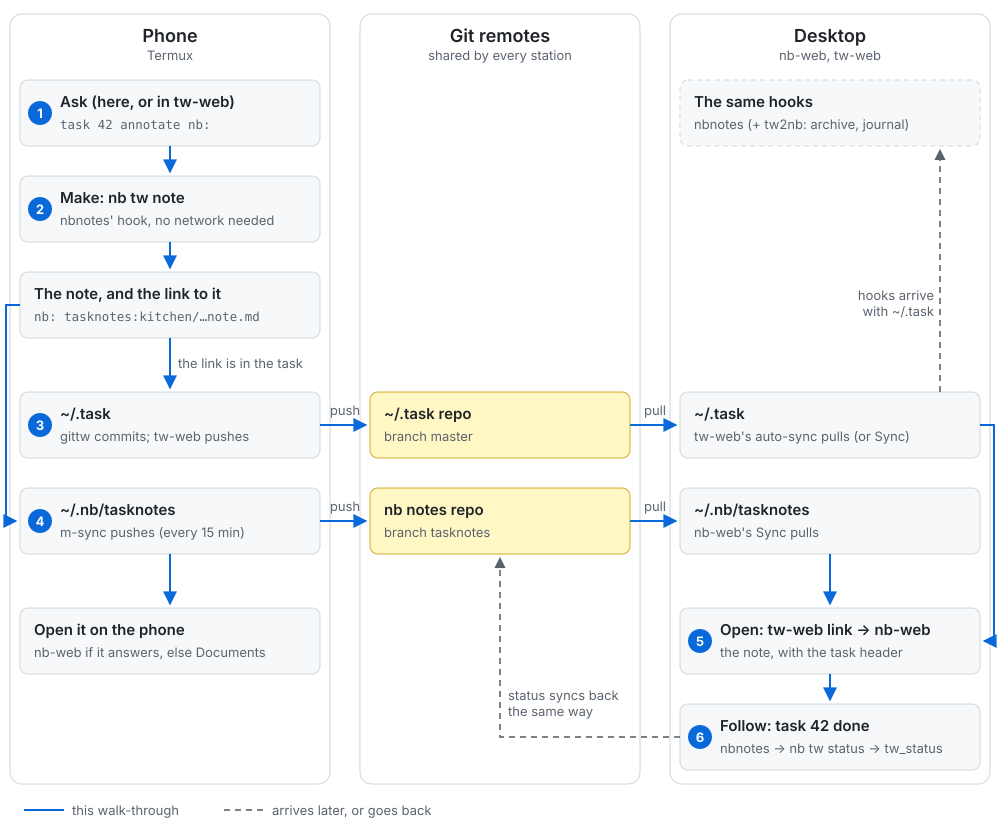

# Task notes: one note per task, on every station

Write `nb:` on a task, and the task gets its own note in [nb](https://github.com/xwmx/nb), linked
both ways. That works from the command line, from tw-web, and on a phone with no connection. The
note follows the task: when the task is done, the note says so. On any station, the link opens
the note: in nb-web when it answers, or in the phone's Documents app when nothing else does.

This page shows how the pieces fit together across stations. Each piece has its own README, linked
under [The pieces](#the-pieces).



## One station is enough

You don't need a phone or a second machine. On a single desktop, nbnotes, the nb plugin `tw`
and nb-web give you task notes. A phone adds the round trip: make the note on the phone, finish
it at the desk, or the other way round.

## Try it

```
task 42 annotate nb:            # makes the note in the tasknotes notebook, and links it
task 42 annotate nb: acme:      # the same, in the acme notebook (mind the trailing colon)
task 42                         # the annotation is now the link:
                                #   nb: tasknotes:kitchen/grout-the-backsplash-1a2b3c4d.note.md
```

The note is named after the task, ending with the first 8 characters of its uuid. If the task has
a project, the note goes in a folder named after the top of the project (`kitchen.tiles` →
`kitchen/`). Its frontmatter names the task back (`tw: <uuid>`) and carries the task's status,
project, priority and tags.

## What you need

| Piece | Desktop | Phone (Termux) | What it does |
|---|---|---|---|
| Taskwarrior 2.6 | yes | yes (`task2`, never Termux's 3.x) | the tasks |
| [nb](https://github.com/xwmx/nb) | yes | yes | the notes |
| nb plugin `tw` ([nb-plugins](https://github.com/linuxcaffe/nb-plugins)) | yes | yes | makes notes and keeps their status (`nb tw note`, `nb tw status`); nbnotes installs it |
| [nbnotes](https://github.com/linuxcaffe/tw-nbnotes-hook) | yes | yes | the hook that calls the plugin when a task changes |
| [gittw](https://github.com/linuxcaffe/awesome-taskwarrior) | for 2+ stations | yes | shares `~/.task` through git |
| [tw-web](https://github.com/linuxcaffe/tw-web) | optional | yes | tasks in a browser; syncs `~/.task` on its own |
| [nb-web](https://github.com/linuxcaffe/nb-web) | yes | optional | notes in a browser; where links open |
| [nb Docs](https://github.com/linuxcaffe/nb-Docs) (based on [Fossify Documents](https://github.com/FossifyOrg/Documents)) | | yes | opens and edits a note when nb-web can't be reached |
| [tw2nb](https://github.com/linuxcaffe/tw2nb) | optional | no | archives finished tasks and keeps a daily journal |
| mobilize (this repo) | | yes | sets up the phone: all of the above, plus m-sync |

## Install

### A desktop

1. **`tw`**, which installs everything else
   ([awesome-taskwarrior](https://github.com/linuxcaffe/awesome-taskwarrior)):
   ```
   curl -fsSL https://raw.githubusercontent.com/linuxcaffe/awesome-taskwarrior/main/install.sh | bash
   ```
   It checks for Taskwarrior and says what to do if it's missing or is 3.x.
2. **Taskwarrior 2.6.2**, if step 1 said it's missing: `tw -I taskwarrior`. On Linux it builds
   2.6.2 into `~/.local`, no sudo; a 3.x is replaced only if you say yes, its tasks saved first.
3. **nb**, the notes: install it as [nb's README](https://github.com/xwmx/nb#installation) says.
   It isn't part of `tw`.
4. **The hook:** `tw -I nbnotes`. With nb there, this also installs the nb plugin `tw` that makes
   the notes.
5. **Try it** as in [Try it](#try-it); `nb tasknotes:list` shows the note.
6. **nb-web**, to read notes in a browser and follow the links: see
   [nb-web's README](https://github.com/linuxcaffe/nb-web). It runs as a server on port 5001,
   not through `tw`.
7. **tw-web** (optional), tasks in a browser: `tw -I tw-web`. Its `nb` launcher already points at
   `http://localhost:5001/#{value}`, so on the same desktop an `nb:` annotation links to nb-web
   with nothing to set.
8. **tw2nb** (optional): `tw -I tw2nb` archives finished tasks and keeps a daily journal in nb.

### A second station, such as a phone

9. **Share `~/.task`.** On the desktop, put `~/.task` in a private git repo with
   [gittw](https://github.com/linuxcaffe/awesome-taskwarrior). Its hooks and settings travel with it.
10. **Share the notebook.** Give `tasknotes` a git remote, one branch per notebook (nb-web's
   Notebooks page wires them). A phone gets it in step 11; another desktop clones it:
   `nb notebooks add tasknotes <remote-url> tasknotes`.
11. **Set up the phone.** In [Termux](https://f-droid.org/packages/com.termux/) (from F-Droid):
   ```
   pkg install python git openssh curl
   curl -fLO https://raw.githubusercontent.com/linuxcaffe/tw-mobilize/main/mobilize.py
   python mobilize.py init --station <name> --data <your ~/.task repo's URL>
   ```
   `init` installs Taskwarrior 2.6.2, clones your tasks, and sets up tw-web and m-sync (every 15
   minutes). Install nb too (`pkg install nodejs && npm install -g nb.sh`), and run `init` again:
   it then checks for the nb plugin and offers to install it. Clone the notebook as in step 10,
   then run `mobilize android`, which walks you through the phone's own
   settings, including [nb Docs](https://github.com/linuxcaffe/nb-Docs) for reading notes offline.
   Details are in [mobilize's README](../README.md#-quick-start-a-new-phone).
12. **Choose the phone's hooks:** gittw and nbnotes, plus any others you want there, but not tw2nb.
    tw2nb's archive and journal would land in notebooks that never sync.
    ```
    mobilize hooks --set 'gittw, nbnotes'
    ```
13. **Point the phone's tw-web at the desktop's nb-web.** In tw-web: Menu → Settings → Annotation
    launchers, set `nb` to `http://<desktop>:5001/#{value}`, where `<desktop>` is an address the
    phone can reach (a VPN such as Tailscale works from anywhere). When the desktop can't be
    reached, the phone opens the note in nb Docs instead.
14. **Install on one station only.** `~/.task` holds the hooks, so what one station installs, the
    others get with the next sync. Name that station in a shared rc file
    (`tw.update_station = <name>`); `tw -I`, `-u` and `-r` on any other station then ask first.

## The round trip, step by step

Here the note starts on the phone; it works the same the other way round.

1. **Ask.** On the phone, `task 42 annotate nb:`, or add the annotation in tw-web.
2. **Make.** When the command finishes, nbnotes runs `nb tw note`. The note is made in the phone's
   `tasknotes`, and the bare `nb:` becomes the link. This needs no network: everything happens on
   the phone.
3. **Share the task.** gittw's hook commits `~/.task`. tw-web's auto-sync pushes it: 60 seconds
   after a change, and every 15 minutes. On the desktop, tw-web's auto-sync pulls it the same way,
   or press Sync in tw-web's menu.
4. **Share the note.** m-sync pushes the phone's `tasknotes` every 15 minutes when there's a
   network. On the desktop, press Sync in nb-web.
5. **Open.** On the desktop the link opens the note in nb-web. In nb-web, the note's header shows
   the task's live status, with buttons to finish or start it, and the `W` key goes to tw-web.
6. **Follow.** Finish the task on either station: nbnotes runs `nb tw status`, and the note's
   frontmatter says `tw_status: completed`. That change syncs back the same way.

Until both syncs have run, the desktop has the link without the note, or the note without the
link. If a link won't open, sync first (see [When a link doesn't open](#when-a-link-doesnt-open)).

## How a link finds nb-web

When you tap a link, tw-web first checks which nb-web answers from where you are: the address
you set in step 13, or the desktop's own nb-web. It opens the first one that answers. If none
does, a phone opens the note in nb Docs, where you can read and edit it; m-sync carries the
edit with the next sync. A desktop says nb-web isn't reachable.

If a device needs an address of its own, the app asks for it and remembers it in that browser
only. nb-web finds tw-web the same way.

Both menus end with a line naming the station and linking to the other app (nb-web's also has
Sign out; tw-web's has Stop). On a phone, that line is the quickest way between the two apps.

## Syncing, and conflicts

| What | Synced by | When |
|---|---|---|
| `~/.task` (tasks, hooks, shared settings) | gittw, through tw-web's auto-sync | 10 s after tw-web starts, 60 s after a change, every 15 min; or tw-web's Sync |
| nb notebooks, phone | m-sync | every 15 min with a network; soon after a quick note |
| nb notebooks, desktop | nb-web's Sync | when you press it |

When the same note was changed on both stations, neither sync leaves conflict markers. The
other station's version keeps the name, and this station's is saved beside it as
`note.conflict-<station>.md`. Sync tells you which notes it set aside. Merge them by hand, then
delete the copy.

## When a link doesn't open

| What you see | Why | What to do |
|---|---|---|
| nb-web: the note won't load | the note hasn't reached this station yet | Sync in nb-web; on the other station, let m-sync or nb-web's Sync run |
| tw-web: a bare `nb:`, not a link | the note hasn't been made: nbnotes isn't in this station's hooks, or the plugin is missing | `mobilize check`; on the desktop, `tw -I nbnotes` |
| tw-web: "nb-web isn't reachable" | no address answered | check the VPN; on the phone, the note opens in Documents |
| a `.conflict-<station>.md` beside a note | both stations changed it | merge by hand, delete the copy |

## The pieces

- [nbnotes](https://github.com/linuxcaffe/tw-nbnotes-hook): the hook.
- [nb-plugins](https://github.com/linuxcaffe/nb-plugins): `nb tw`, which makes and updates task notes.
- [tw2nb](https://github.com/linuxcaffe/tw2nb): the archive and journal (optional, desktop).
- [tw-web](https://github.com/linuxcaffe/tw-web): `nb:` links on tasks, the `N` key, the menu line.
- [nb-web](https://github.com/linuxcaffe/nb-web): the task header, the `W` key, the menu line.
- [awesome-taskwarrior](https://github.com/linuxcaffe/awesome-taskwarrior): `tw -I`, gittw, the update station.
- mobilize ([README](../README.md)): the phone, m-sync, Documents.
